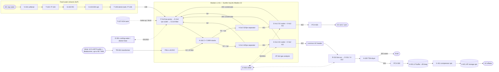

# PFD and mass & energy balance: 4 × Sunfire HyLink Alkaline 22 (40 MW)

Starting point for designing a PFD and a mass & energy balance for the mijnwindparknl site with four Sunfire HyLink Alkaline 22
modules (4 × 10 MW DC = 40 MW). The process order comes from the MTSA design for GROHW Deventer, adapted from PEM to pressurised
alkaline.

- Workbook: [`excel/PFD-massa-energiebalans-Sunfire-4x10MW.xlsx`](../excel/PFD-massa-energiebalans-Sunfire-4x10MW.xlsx). Every
  number is a formula on the *Inputs* sheet. Rebuild it with `python3 scripts/build-pfd-balance-excel.py`.
- Sources:
  - MTSA *Starting points GROHW WP3* 1900601R-008 rev 2, schematic 1900601R-007, PFD 1900601R-009 rev 1, mass balance
    1900601R-010 rev 0, and W+B appendices VIII–X.
  - Sunfire HyLink Alkaline 22 datasheet (`elektrolyser-atlas/AlkalineElectroLysis/Sunfire_10MW.pdf`).

## 1. MTSA components in process order

MTSA's process order is physically correct. The tags below are from PFD 009. The report text still uses the older tags from
schematic 007.

| # | Tag | Component | Streams |
|---|---|---|---|
| **Feed water** | | | |
| 1 | V-111 | Water softener | 101 → 111 (waste 131) |
| 2 | T-121, P-122 | Break tank and RO feed pump | 111 → 121 |
| 3 | S-123 | Reverse osmosis | 121 → 122 (reject 132) |
| 4 | S-124 | EDI cell (to 0.055 µS/cm) | 122 → 141 (reject 133) |
| 5 | T-151 (+ S-152 CO₂ lock) | UPW break tank | 141 + 142 + 143 |
| 6 | P-152 | UPW feed pump | → 151 |
| 7 | S-161 | Demi cartridges (ion-exchange polishing) | 151 → 161 → V-201 |
| **Anode loop / O₂** | | | |
| 8 | V-201 | O₂ gas–liquid separator (4.2 barg) | 161, 213, 311 in; 171, 211, 142 out |
| 9 | P-211 | UPW circulation pump | 211 |
| 10 | E-212 | Stack cooler (cooling water 55/60 °C) | 221/222 |
| 11 | S-213 | Filter | → 212 |
| 12 | A-231 / A-251 | PEM stacks, 1 MW each | 212 → 213 (UPW + O₂), 301 (H₂ + water) |
| 13 | E-202 | O₂ cooler, condensate → T-151 | 171 → 172, 143 |
| 14 | PCV | O₂ back-pressure valve → user/vent | 172 |
| **H₂** | | | |
| 15 | V-301 | H₂ gas–liquid separator (40 barg) | 301 → 312, water 311 → V-201 |
| 16 | A-321 / A-331 / A-341 | De-oxo + dryer (Grade D) / no treatment / cooler + knock-out | 321 / 331 / 341 |
| 17 | PCV | Holds the electrolyser at 40 barg | |
| 18 | V-401 | LP buffer (35–37 barg) | 401 |
| 19 | A-411 | Compressor (optional) | 411 |
| 20 | V-421 | HP storage (optional) | 421 → end user |
| **Utilities** | | | |
| 21 | E-351, P-411 | Glycol chiller loop 10/25 °C for E-202, A-321 and A-341 | 351–358 |
| — | | N₂ purge, instrument air, transformer/rectifier, cooling water | |

### What doesn't match in the MTSA documents

These are labelling problems. They don't change the process order, except item 5, which is a safety point.

1. **Tags in the text vs PFD 009.** The text says S-101, V-151 and S-221. PFD 009 uses V-111…S-124, T-151 and S-161.
2. **Where the polishing sits.** The text puts ion exchange S-221 inside the circulation loop. PFD 009 moves it to a side stream:
   V-201 → T-151 → P-152 → S-161 → V-201. Both work. The side stream keeps the resin out of the full 60 °C flow.
3. **Mass-balance typo.** Stream 354 is labelled "from E-301". There is no E-301; it should be E-202.
4. **Pump numbering.** Pump P-411 belongs to the cooling loop (350 series), but 400 is the storage series. P-351 would fit.
5. **H₂ letdown (safety).** Stream 311 (1.1 t/h of water at 40 barg) is let down into V-201 at 4.2 barg. Dissolved H₂ flashes
   into the O₂ vessel. No level-control valve is drawn. Take this into the HAZOP.
6. **2 MW end of life.** W+B appendix VIII gives a stack ΔT of 6.1 K, above the 5.5 K limit ("NO"). Circulation must be sized
   for end of life.

The *MTSA check* sheet recomputes MTSA's 1 MW BOL balance:
- water recovery: softener 96 %, RO 80 %, EDI 90 %, so 69 % overall;
- O₂ produced, 52.99 kWh/kg DC and 13.06 kg water per kg H₂;
- stack heat of 242–283 kW.

The *Balance* sheet uses the same method.

## 2. From PEM (MTSA) to pressurised alkaline (Sunfire)

| Area | MTSA (PEM) | HyLink Alkaline 22 |
|---|---|---|
| Electrolyte | UPW, anode side only | 25–30 wt% KOH lye on both sides |
| Gas pressure | H₂ 40 barg, O₂ 4 barg | H₂ 30 barg. O₂ assumed at about the same pressure |
| Separators | V-201 (O₂/UPW) and V-301 (H₂/water) | H₂/lye and O₂/lye separators, inside Sunfire's scope. The level balance between them is critical |
| Water quality | UPW 0.055 µS/cm, polishing in the loop | Demin water, typically < 1–5 µS/cm (confirm with Sunfire). No ion exchange on the lye. EDI may be optional |
| Make-up | Pumped to 4.2 barg | Pumped into a 30 barg system |
| Condensate | O₂-cooler condensate → UPW tank | Gas-cooler condensate contains KOH and goes back to the lye |
| Gas cooling | Optional (A-341) | Always needed: gas cooler and demister for lye mist |
| New items | — | KOH storage, make-up and drain tank; gas analysis (H₂-in-O₂ interlock) |
| Gas cleaning | A-321 de-oxo + dryer, optional | De-oxo → dryer for 99.998 %. The datasheet calls it load dependent and doesn't say whether it is in scope |
| Scope | MTSA builds everything | Sunfire supplies a 10 MW module: Power Supply Unit, Core Electrolysis Unit (2 × 5 MW stacks), Liquid & Gas skid, Fleet Control. Everything else is BoP |

## 3. Proposed PFD (4 modules)

`x` is the module number (1–4). Everything inside the dashed box is repeated for each module and is Sunfire scope.

The full equipment list (31 items, with scope and the MTSA equivalent) is on the *Alkaline PFD* sheet. The process order is:
power → feed water → lye loop/stacks → gas–lye separation → gas cooling/knock-out → common header → de-oxo → dryer →
back-pressure valve → buffer → compressor → storage. O₂ goes from cooling/knock-out to the back-pressure valve and then to the
vent or a user.

## 4. Mass & energy balance (full load, BOL, defaults)

| | Per module | Plant (4×) |
|---|---|---|
| AC power drawn (52.2 kWh/kg) | 10.44 MW | 41.8 MW |
| DC power / transformer + rectifier losses / BoP | 10 / 0.26 / 0.18 MW | 40 / 1.0 / 0.7 MW |
| H₂ from stacks (Faraday) | 200 kg/h | 800 kg/h |
| Net dry H₂ to buffer (after de-oxo and 1 % dryer regeneration loss) | 196.7 kg/h | 787 kg/h (18.9 t/d) |
| O₂ | 1,581 kg/h | 6,323 kg/h |
| Demin make-up / tap water / waste water | 1.79 / 2.59 / 0.80 t/h | 7.16 / 10.4 / 3.2 t/h |
| Tap water per kg H₂ | 13.2 kg/kg | (MTSA PEM: 13.06) |
| Stack heat (P_DC − H₂·HHV) | 2.12 MW | 8.5 MW |
| Lye cooler duty | 1.89 MW | 7.6 MW (651 t/h CW at ΔT 10 K) |
| Gas coolers + de-oxo (glycol) | 0.12 MW | 0.47 MW |
| Total heat rejection | 2.26 MW | 9.1 MW |
| Mass-balance closure | 0 kg/h | 0 kg/h |

At full load the plant draws 41.8 MW, against up to 48.7 MW of wind supply. That leaves 6.9 MW of margin. The existing
/opsplitsing model uses 44 MW of stacks + 10 % BoP. These 40 MW of stacks are a separate case.

### Assumptions to confirm with Sunfire

The datasheet doesn't give these. They are all yellow cells on the *Inputs* sheet.

- Stack/lye temperature: 80 °C.
- O₂-side pressure: 30 barg, the same as the H₂ side.
- Lye ΔT over the stack: 10 K.
- Feed-water specification.
- Whether 200 kg/h is gross (before gas cleaning) or net.
- Whether 52.2 kWh/kg is the full-load or the end-of-life figure, and what it includes (cooling, gas cleaning).
- Split between rectifier losses and BoP.
- Purity before gas cleaning: 99.8 %, conservatively counted as all O₂.
- H₂ in O₂: 0.5 %.
- Dryer regeneration loss: 1 %.
- The offtake pressure, which sets whether you need the compressor and HP storage (enter `p_end`).

Size the coolers for end of life. As the cell voltage rises, the stack heat grows. MTSA's 2 MW case goes from 53.0 to
59.8 kWh/kg.
